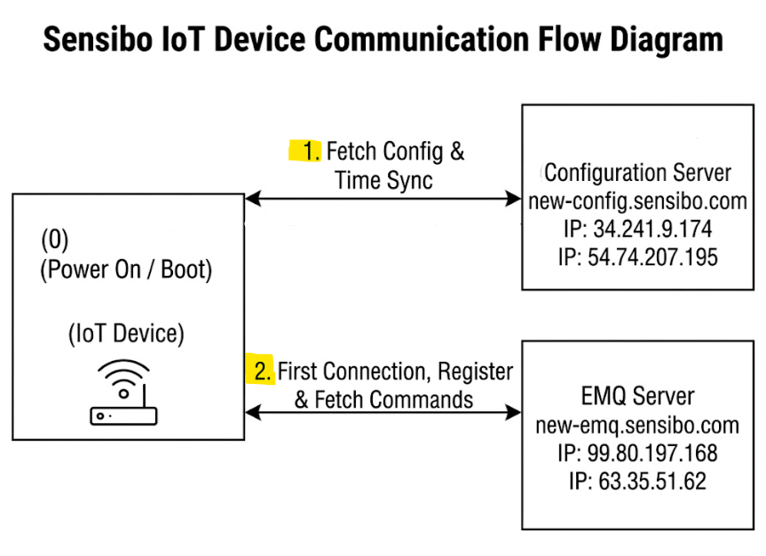

# אימות תעודת TLS לקוי בבקר מיזוג חכם של Sensibo

| **פרטים אישיים** | ניסים אל פקס                                                                                 |
| ---------------- | -------------------------------------------------------------------------------------------- |
| **תאריך**        | אוקטובר 2026                                                                                 |
| **יעד**          | בקר מיזוג חכם של Sensibo (IoT)                                                               |
| **קטגוריה**      | Improper Certificate Validation - [CWE-295](https://cwe.mitre.org/data/definitions/295.html) |
| **חומרה**        | נמוכה–בינונית (רשת סמוכה / Adjacent; פגיעת סודיות)                                                     |
| **סטטוס**        | דווח אחראית ל-Sensibo בתאריך 09.10.2026                                                      |
| **היקף**         | מכשיר, חשבון ורשת בבעלות החוקר בלבד                                                          |

---
## תקציר (TL;DR) 

 מכשיר ה- Sensibo **אינו מאמת את תעודת השרת בשכבת ה-TLS**, ומסתמך אך ורק על certificate pinning בשכבת האפליקציה שנאכף **לאחר** השלמת ה-handshake.
 מכיוון שהבדיקה מתבצעת מאוחר מדי, לקוח ה-MQTT (המכשיר) שולח את פרטי ההתחברות של המכשיר (שם משתמש + אסימון) אל השרת (שטרם אומת בתור השרת האמיתי של Sensibo).
 ובפועל - המזהים יכולים להגיע אל תוקף on-path **לפני** שהרכיב מזהה בעזרת pinning את השרת המזויף ומנתק את התקשורת.

כתוצאה מכך, מימוש MITM יציב דרך proxy אינו ישים (ה-pinning סוגר כל חיבור שאינו מציג את התעודה האמיתית), **והחשיפה מצטמצמת לדליפת credentials בחלון הקצר שלפני הניתוק**. הזרקת פקודות אינה אפשרית - גם משום שה-broker אוכף ACL מסוג subscribe-only על נתיבי הפקודות, וגם משום שה-pinning המאוחר מונע קיום MITM יציב דרך proxy.

עם זאת, הדלפת הcreds מאפשרת האזנה פסיבית על הפעולות הלגיטימיות שהרכיב  מבצע מול הברוקר MQTT (פקודות IR / state), מה שחושף דפוסי שימוש ו**נוכחות בבית** (מתי המזגן דולק/כבוי).

---
## 1. היקף והרשאה

- כל הבדיקות בוצעו **אך ורק על מכשיר, חשבון ורשת בבעלות החוקר.**
- לא בוצעה גישה למכשיר, חשבון או נתונים של צד שלישי.
- לא בוצעה חדירה לתשתית הענן של Sensibo.
- מטרה: הערכת אבטחה ודיווח אחראי.

---

## 2. סריקה ראשונית (Recon)

סריקת רשת זיהתה את בקר ה-Sensibo ברשת המקומית:

```
nmap -sn 192.168.0.1/24        # host discovery        
nmap -T4 -A -p- <device-ip>    # full port / service scan    
```

| פריט          | ערך                                |
| ------------- | ---------------------------------- |
| IP המכשיר     | `192.168.1.121` (פרטי)             |
| MAC           | `<צונזר>`                          |
| פורטים פתוחים | **אין** (אין שירותים נגישים מבחוץ) |
| טביעת אצבע    | מחסנית `lwIP` מוטמעת               |

**תצפית:** נראה כי מזהי שאילתות ה-DNS **אינם אקראיים**, מה שהופך DNS spoofing לטריוויאלי - תנאי קדם שימושי לתקיפה שלהלן.

מאחר שהמכשיר אינו פותח פורטים, המחקר עבר מ"לתקוף את המכשיר" ל**ניתוח התקשורת היוצאת שלו.**

---

## 3. ארכיטקטורת התקשורת

ניתוח התעבורה (לאחר ARP spoofing) הראה שהמכשיר עובד בשני ערוצים:

| דומיין                   | פרוטוקול          | תפקיד                                |
| ------------------------ | ----------------- | ------------------------------------ |
| `new-config.sensibo.com` | HTTPS             | משיכת קונפיגורציה ראשונית            |
| `new-emq.sensibo.com`    | **MQTT over TLS** | רישום + קבלת פקודות/עדכונים (broker) |

המכשיר **נרשם (subscribe)** ל-topic שלו ומקבל עדכונים שמקורם בענן של Sensibo. (שליטה יזומה מהאפליקציה נשלחת ל-REST API, שמעדכן בתורו את ה-broker - כלומר המכשיר הוא ה*צרכן* של הפקודות, לא המפרסם.)

תעודת השרת בשני הדומיינים חתומה ע"י **CA פרטי של Sensibo**, מה שהעלה בתחילה חשד שהמכשיר אוכף certificate pinning:

```
Signature Algorithm: sha1WithRSAEncryption
Issuer : C=IL, O=Sensibo Ltd.
Subject: C=US, ST=Some-State, O=Sensibo, CN=*.sensibo.com
Validity: 2018 → 3017
```

---

## 4. הקמת המעבדה (MITM)

כדי ליירט את תעבורת ה-TLS, נבנו שרת מזויף ומערך תעודות:

1. תעודת CA מזויף ומפתח פרטי שנוצרו עצמאית. 
2. **תעודת שרת מזויפת** - `CN=*.sensibo.com` (תואם לג'וקר המקורי) בתוספת SAN עם ה-IP הלוקאלי, חתומה ע"י ה-CA המזויף. מפתח + תעודה אוחדו ל-`server.pem`.
3. ממשק **stunnel** - מסיים TLS על `:443` ומעביר plaintext ל-**mosquitto** מקומי.
4. **הפניה** - המכשיר הוכרח לבצע בקשת DNS מחודשת לדומיין והופנה לפרוקסי המקומי באמצעות **ARP + DNS spoofing**.

## 5. תצפית בסיס - פעילות תקינה

נצפה בפעילות ללא התערבות (כבסיס להשוואה):

- באתחול, המכשיר **קודם מושך קונפיגורציה** מ-`new-config`, ואז מתחבר ל-`new-emq` ו**נרשם** ל-topic כדי לקבל עדכונים.
- המכשיר **לא** ממשיך ל-`new-emq` לפני שמשיכת הקונפיגורציה הצליחה.
- כל סשן מסתיים ב-`FIN` ואחריו `RST`.




---

## 6. הממצא העיקרי - אין אימות תעודת TLS (CWE-295)

בוצעו שלושה ניסויים **מבוקרים**, שבהם שונתה רק התעודה שהציג השרת המזויף:

| #   | התעודה שהוצגה                               | לחיצת יד TLS | תוצאה                                |
| --- | ------------------------------------------- | ------------ | ------------------------------------ |
| 1   | `CN=*.sensibo.com`, `O=Sensibo` (תואם מקור) | **הושלמה**   | נשלח MQTT CONNECT → credentials דלפו |
| 2   | **CN אקראי**, `O=Sensibo`                   | **הושלמה**   | credentials דלפו                     |
| 3   | **CN אקראי** *וגם* **O לא קשור**            | **הושלמה**   | credentials דלפו                     |

**מסקנה:** שכבת ה-TLS מקבלת **כל** תעודה - ללא אימות שרשרת וללא אימות שדות (CN/O). אילו המכשיר היה מאמת או נועל תעודה בשכבת ה-TLS, הוא היה שולח `bad_certificate` באמצע ה-handshake ולא מגיע ל-`Finished` כלל. במקום זאת, המכשיר מסתמך **אך ורק על certificate pinning בשכבת האפליקציה, שנאכף רק לאחר השלמת ה-handshake.**

---

## 7. ההשפעה - דליפת Credentials על־גבי הרשת

שני הערוצים מתנהגים שונה, וזה מדייק את הכשל:

| ערוץ                   | הרצף שנצפה                                                          | הסבר                                                              |
| ---------------------- | ------------------------------------------------------------------- | ----------------------------------------------------------------- |
| **new-emq** (MQTT)     | TLS מסתיים → המכשיר שולח **MQTT CONNECT (credentials)** → ואז מתנתק | לקוח MQTT שולח CONNECT מיד, **לפני** שבדיקת ה-pin מנתקת           |
| **new-config** (HTTPS) | TLS מסתיים → החיבור נסגר **מיד, ללא תוכן**                          | לקוח HTTP מריץ את בדיקת ה-pin **לפני** שליחת הבקשה → כלום לא דולף |

ב-`new-emq`, הודעת ה-MQTT `CONNECT` חשפה את **שם המשתמש והאסימון** של המכשיר (שניהם צונזרו מהדוח). האסימון הוא סוד ארוך־טווח, ייחודי למכשיר.

**השפעת הדליפה בעולם האמיתי:** עם ה-credentials, תוקף יכול להתחבר ל-broker ו**להאזין** לתעבורת המכשיר (פקודות IR / state), מה שחושף דפוסי שימוש ו**נוכחות בבית** (מתי המזגן דולק/כבוי).

### 7.1 הוכחת השפעה - האזנה בעזרת ה-Credentials שדלפו

כדי לוודא שה-credentials שדלפו באמת שמישים, התחברתי איתם ל-broker ה**אמיתי** של Sensibo, כלקוח רגיל:

1. **האימות הצליח.** ה-broker קיבל את ה-credentials (`CONNECT rc = 0`), מה שמאשר שהם תקפים מול ה-broker  - לא רק בתוך המעבדה שלי.
2. **האזנה עובדת.** הרשמה (subscribe) ל-topic של המכשיר (`things/1/<device-id>/#`) החזירה את **הזרם החי של תעבורת המכשיר** - גלי פקודות ה-IR ועדכוני ה-state. הפעלת המזגן מהאפליקציה יצרה סדרה רציפה של הודעות שהתקבלו בזמן אמת, כלומר יכולתי לראות בדיוק **מתי המזגן נדלק/כבה.**
3. **הזרקת פקודות חסומה.** ניסיון לפרסם (publish) לנתיבי הפקודות (`.../cmd`, `.../ir/...`) לא השפיע. בדיקת שני חיבורים (מנוי + מפרסם, שניהם עם זהות המכשיר) הראתה שהודעות שפורסמו בזהות המכשיר **לא נותבו כלל**, בעוד תעבורת הענן האמיתית התקבלה כרגיל. לכן זהות המכשיר היא **subscribe-only** על נתיבי הפקודות (ACL בצד ה-broker).

**מסקנה:** ה-credentials שדלפו **אינם חסרי ערך**. הם מקנים יכולת **האזנה** אמיתית על מכשיר הקורבן - פגיעת סודיות שחושפת דפוסי שימוש ונוכחות - אך **לא שליטה**, שכן ה-ACL חוסם פרסום פקודות.

---

## 8. מדוע stable MITM אינו ישים

ניסיון להקים חיבור יציב בין המכשיר לשרת האמיתי של Sensibo נשלל. המכשיר משלים את ה-TLS handshake מול כל תעודה, אך ה-**pinning בשכבת האפליקציה** בודק אז את התעודה ו**סוגר את החיבור** אם אינה התעודה האמיתית של Sensibo. ללא המפתח הפרטי של Sensibo, לא ניתן להחזיק חיבור יציב.

**חלון החשיפה היחיד הוא הרגע הקצר שבו נשלחים ה-credentials לפני שה-pinning מנתק.** לכן הזרקת פקודות למכשיר דרך פרוקסי כזה **אינה אפשרית.**

---

## 9. כיוונים שנשללו (תוצאות שליליות)

- **השערת השיהוי/timeout** - בתחילה שיערתי שההתנתקות נובעת משיהוי של הפרוקסי שגורם ל-timeout בצד הלקוח. נשלל: הבדיקות בוצעו ברשת מקומית ללא עיכוב משמעותי, וההתנתקות מתרחשת ב**שכבת האפליקציה** (אחרי `Finished`), ולא כ-timeout של חיבור. זה תומך בתזת ה-pinning.
- **דרדור לפורט 80** - חסימת פורט 443 (`iptables DROP`) כדי לכפות cleartext **לא** גרמה ל-fallback לפורט 80 או לכל פורט חלופי. המכשיר **אינו** מדרדר ל-cleartext - נקודת חוזק.

---

## 10. הערכת השפעה ונקודות חוזק

| מימד       | השפעה                                  | סטטוס    |
| ---------- | -------------------------------------- | -------- |
| **סודיות** | קצירת credentials + האזנה              | **מוכח** |
| **שלמות**  | הזרקת פקודות **נחסמה** (ACL + pinning) | מוגן     |
| **זמינות** | לא נפגעה באופן משמעותי                 | -        |

**וקטור מוערך:** `AV:A/AC:H/PR:N/UI:N` - רשת סמוכה (Adjacent), ללא הרשאות, ללא אינטראקציית משתמש; פגיעת סודיות בלבד.

**הגנות שעמדו (ראוי לציין):**
- אסימון ייחודי למכשיר (לא סוד משותף).
- הצפנת TLS על כל התעבורה.
- מנגנון **ACL** בצד ה-broker (זהות המכשיר היא subscribe-only → לא יכולה לפרסם פקודות).
- **אין דרדור ל-cleartext.**
- מנגנון pinning **מאוחר** חוסם התחזות לשרת לצורך MITM יציב.

---

## 11. המלצות

1. **לאכוף אימות שרשרת תעודה ו/או pinning בשכבת ה-TLS** - תיקון שורש הבעיה.
2. **להתנות את שליחת ה-credentials בהצלחת אימות השרת** - לא לשלוח MQTT `CONNECT` לפני שזהות השרת אומתה.
3. **לאקראי את מזהי שאילתות ה-DNS** כדי להקשות על DNS spoofing.
4. לשקול **סבב/ביטול אסימון** זמין למשתמש לאחר חשד לדליפה.

---

## 12. דיווח אחראי

הבעיה דווחה ל-Sensibo בתאריך 09.10.2026.
כל ה-credentials והמזהים של המכשיר **צונזרו** מהדוח, ולא נכלל קוד ניצול המאפשר שימוש חוזר טריוויאלי.

---

## נספח - ראיות

| #        | Type       | Description                                                                                                                                                       |
| -------- | ---------- | ----------------------------------------------------------------------------------------------------------------------------------------------------------------- |
| E0       | screenshot | flow diagram that describe the device communication method                                                                                                        |
| E1       | screenshot | Server certificate details (private Sensibo CA, CN=*.sensibo.com)                                                                                                 |
| E2       | screenshot | altered Server certificate details (private Sensibo CA, CN=*.sensi**g**o.com)                                                                                     |
| E3       | screenshot | Cert-variation tests (random CN / O) - handshake still completes                                                                                                  |
| E4       | screenshot | MQTT CONNECT leaking username + token (both redacted)                                                                                                             |
| E5 + E51 | screenshot | TLS handshake completes on `new-emq`, immediately followed by the MQTT `CONNECT` packet leaking the username + token.                                             |
| E6       | screenshot | On `new-config`, the device completes the handshake against the forged cert but returns no data and retries - showing its dependency on a successful config pull. |
| E7       | screenshot | PoC: CONNECT rc=0 + AC on/off commands received (client id redacted)                                                                                              |

---

*כל הבדיקות בוצעו על ציוד, חשבונות ורשתות בבעלות החוקר בלבד. ה-credentials צונזרו ולא ייחשפו. דוח זה פורסם למטרות חינוכיות והגנתיות.*
